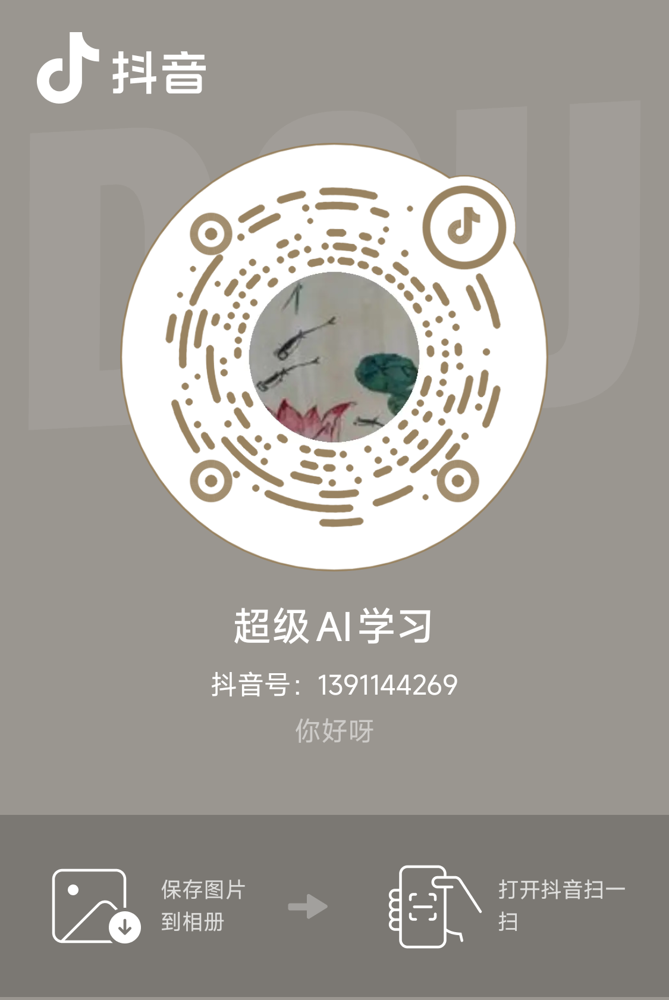
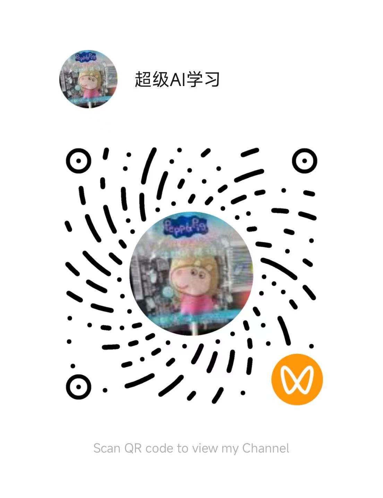

# WWW DotA

A fan-made port of classic DotA that runs in the browser: a 5v5 MOBA against bots, with no client or install. It can be installed as a PWA and played offline after one visit.

浏览器里的 DotA：经典 DotA 的网页移植版，5v5 对战电脑，无需安装客户端。

## Play now / 立即游玩

**▶ https://huaichaow.github.io/wwwdota/**

We recommend desktop **Chrome**. Other browsers haven't been fully tested. After the first load you can install it from the address bar and play offline against bots.

## 健康游戏忠告 / Healthy Gaming Advisory

> 抵制不良游戏，拒绝盗版游戏。 
> 注意自我保护，谨防受骗上当。 
> 适度游戏益脑，沉迷游戏伤身。 
> 合理安排时间，享受健康生活。
>
> Reject harmful and pirated games. Protect yourself and beware of scams. 
> Gaming in moderation is good for the mind; addiction harms the body. 
> Plan your time wisely and enjoy a healthy life.

## How to play / 玩法

1. On the hero select screen, pick a hero (or **🎲 Random hero**) and set the ally and enemy bot difficulty (Easy / Normal / Hard).
2. Bots draft the other nine heroes: four join you on the **Sentinel**, five fight for the **Scourge**.
3. Destroy the enemy **Ancient** to win.

Tip: last-hit enemy creeps for gold, and deny your own creeps once they fall below half health to rob the enemy of gold and experience.

### Mouse / 鼠标

| Input | Action |
| --- | --- |
| Right-click ground | Move |
| Right-click unit | Attack (or deny an ally below half HP) |
| Left-click / drag | Select units |
| Left-click (while targeting) | Cast spell / confirm attack-move |
| Right-click (while targeting) | Cancel |
| Alt + left-click | Ping the map |
| Ctrl + click ability, or its **+** button | Learn the skill |
| Right-click ability icon | Toggle autocast |
| Mouse wheel | Zoom |
| Middle-drag, arrow keys, or screen edge | Pan the camera |
| Left-click / drag minimap | Move the camera (or attack-move while targeting) |
| Right-click minimap | Move there |
| Drag items | Rearrange the inventory and stash |

### Hotkeys / 快捷键

These are the defaults. You can rebind all of them in **Settings → Hotkeys** (Esc / F10).

| Key | Action |
| --- | --- |
| Hero's DotA keys (shown on its ability buttons) | Cast abilities |
| Alt + ability key | Learn that skill |
| Shift + ability key | Toggle autocast |
| `1` – `6` | Use item in slot 1–6 |
| `A` | Attack-move |
| `S` | Stop |
| `H` | Hold position |
| `B` | Shop |
| `Space` | Center the camera on your selection (hold to follow your hero) |
| `Y` | Lock / unlock the camera |
| `` ` `` (hold) | Scoreboard |
| `Left Alt` (hold) | Show attack range |
| `F1` | Select your hero (double-tap to center on it) |
| `F2` | Select all your units |
| `F3` | Select your other units (summons, illusions) |
| `Tab` / `Shift+Tab` | Cycle through unit types in the selection |
| `7` `8` `9` `0` | Recall a control group (`Ctrl` + key assigns it) |
| `P` | Pause |
| `F9` | Toggle game speed |
| `Esc` / `F10` | Settings (Esc also closes the shop and other panels) |

**Ability keys:** by default each hero uses its original DotA hotkeys. To use `Q` `W` `E` `R` for every hero (with `D` `F` `C` `V` for extra abilities), go to **Settings → Interface → Ability keys** and choose *Ability 1-4 keys*.

**Key conflicts:** if a hero's ability uses a command key, the ability wins and the command moves to `Ctrl` + that key. For example, it's `Ctrl+B` for the shop, or `Ctrl+A` for attack-move with Earthshaker.

In game, the help line at the bottom of the screen always shows your current bindings.

## 关注我 / Follow Me

| 抖音 / TikTok (Douyin) | 视频号 / WeChat Channels |
| :---: | :---: |
|  |  |

## 免责声明

1. 本仓库中包含大量受版权保护的内容（包括但不限于游戏素材、图片、音频、角色形象、名称及商标等），其版权归各自的权利人所有。
2. 本仓库仅供个人学习与技术研究使用，**严禁用于任何商业用途**。
3. 任何人对本仓库内容进行复制、转载、分发、传播或部署公开访问，由此产生的一切侵权问题及法律责任均由使用者自行承担，与本仓库作者无关。
4. 如果您是相关内容的权利人，认为本仓库侵犯了您的合法权益，请联系作者，我们将及时删除相关内容。
5. 下载、克隆或使用本仓库内容，即表示您已阅读并同意上述声明。

## Disclaimer

1. This repository contains a large amount of copyrighted material (including but not limited to game assets, images, audio, characters, names and trademarks). All copyrights belong to their respective owners.
2. This repository is intended for personal learning and technical research only. **Any commercial use is strictly prohibited.**
3. Anyone who copies, reposts, distributes, shares or publicly deploys the contents of this repository is solely responsible for any resulting copyright infringement and legal liability. The author of this repository assumes no responsibility.
4. If you are a rights holder and believe this repository infringes your legitimate rights, please contact the author and the relevant content will be removed promptly.
5. By downloading, cloning or using the contents of this repository, you acknowledge that you have read and agree to this disclaimer.
